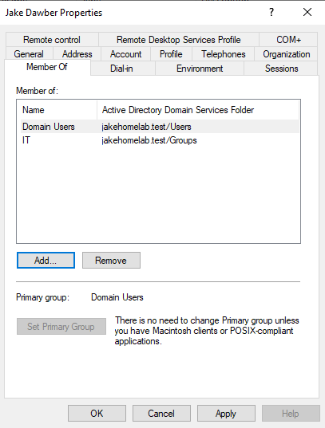

<h1>Creating Organisational Units (OUs) and Security Groups</h1>

<h2>Objective</h2>

Organise the Active Directory environment to represent a company with multiple geographical locations and departments. This provides a structured foundation for user management, access control and Group Policy deployment.

<b>Implementation</b>

1. Created geographical Organisational Units

Created separate OUs for Manchester, London and Birmingham to represent the company's different office locations. Within each location, I created additional OUs for Users, Computers and Servers to keep directory objects organised by type.

2. Created a dedicated Groups OU

Created a separate OU to centralise departmental security groups, keeping group management separate from the geographical structure.

3. Created departmental security groups

Created four Global Security Groups within the Groups OU:

Finance, HR, IT, Management

These groups provide a foundation for managing departmental permissions and assigning access to resources based on role.

4. Created a user account and assigned group membership

Created my own test user account and added it to the IT security group. I verified the membership through the user's Member Of tab in Active Directory Users and Computers.

This demonstrates how user accounts can be associated with departmental groups rather than managing permissions individually for every user.

<b>Skills Demonstrated</b>

Active Directory Users and Computers (ADUC)

Organisational Unit (OU) creation and directory structure design

User account administration

Global Security Group creation

Group membership management

Foundational role-based access control (RBAC) concepts

<b>Outcome</b>

Established a structured Active Directory directory hierarchy with geographical OUs, dedicated user/computer/server containers and centralised departmental security groups. This structure provides a foundation for the next stages of the lab, including employee onboarding, workstation domain joining and Group Policy configuration.

